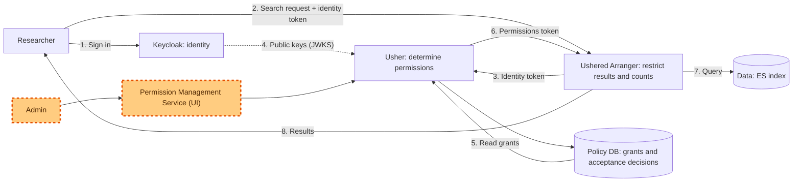

# Overview

Usher is the access policy system for Overture. It defines what data a person can access and what actions they can perform; the applications it serves then enforce those decisions for each request.

:::important
**This overview and the worked examples describe backend functionality:** specifically how permissions are represented, evaluated, and enforced. Designing how users interact with those functions and sustainably maintain their policies is the next step, briefly outlined in [Permission Management](04-permission-management.md).
:::

### The problem Usher solves

Different users may be allowed to access different data or perform different actions on the same data. Those permissions must be applied consistently wherever the data is served, including search results, counts, and downloads. When each application defines its own access rules, permissions become harder to keep aligned, change, and audit. Usher centralizes permission decisions so applications can enforce a shared policy as access is granted, changed, or revoked.

## Where Usher fits

Access control spans three responsibilities:

1. Establish identity through accounts and sign-in (**Keycloak**)
2. Determine permitted data and actions (**Usher**)
3. Enforce permissions on search and downloads (**Ushered Arranger**)

Usher holds the grants and the recipients' acceptance decisions. A permission interface would connect user actions to those backend operations. Keycloak is the initial identity provider. Keeping authorization separate allows Usher to integrate with other identity systems.

**The admin flow shown above is a planned next step, not part of the Usher specification.** The Permission Management Service (UI) and the admin's workflow through it are future design work outlined in [Permission Management](04-permission-management.md). Usher's specification defines the admin API and the underlying grant model that supports it. These capabilities enable a permission management UI and its workflows.
