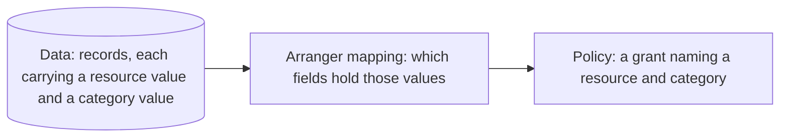

# Concrete examples

## Basic Example

This walkthrough works through a minimal, platform-agnostic scenario, following the same four-part structure as the project-specific examples in the following sections: the data, the corresponding Arranger mapping, and the policy, as diagrammed below.



Every record carries a resource value and a category value among its fields; the mapping says which fields those are. The policy then refers to a resource and a category by name, using the same values the mapping points at. This links the policy to the records it applies to.

### 1. The problem being solved

In this example, we want to define access to records: some should be open to everyone, while others should be reachable only by someone with permission.

### 2. The data being governed

The following is our example dataset, from the made up Arranger catalogue `my_data_index`.

| `data_label` | `sensitivity_label` | `sample_type` | `donor_identifier` | `age_at_collection` | `tissue_source` | `sequencing_platform` | `library_strategy` | `collection_date` | `submission_status` |
| ------------ | ------------------- | ------------- | ------------------ | ------------------- | --------------- | --------------------- | ------------------ | ----------------- | ------------------- |
| `dataset_A`  | `PUBLIC_DATA`       | `reference`   | `DONOR_001`        | `45`                | `blood`         | `illumina_novaseq`    | `wgs`              | `2023-01-10`      | `published`         |
| `dataset_A`  | `CONTROLLED_DATA`   | `tumour`      | `DONOR_002`        | `61`                | `tissue`        | `illumina_novaseq`    | `wgs`              | `2023-03-22`      | `published`         |
| `dataset_B`  | `PUBLIC_DATA`       | `reference`   | `DONOR_006`        | `39`                | `blood`         | `illumina_novaseq`    | `wgs`              | `2023-02-05`      | `published`         |
| `dataset_B`  | `CONTROLLED_DATA`   | `tumour`      | `DONOR_003`        | `58`                | `tissue`        | `illumina_hiseq`      | `wxs`              | `2023-05-14`      | `published`         |

### 3. The corresponding Arranger mapping

The following is the mapping that will connect the dataset above to Usher. A registration like this is what the catalogue above would need:

```json
{
  "catalogue_id": "my_data_index",                              // What Arranger catalogue are we configuring?
  "resource_field": "data_label",                               // What field holds the record's resource value?
  "resources": ["dataset_A", "dataset_B"],                      // What resources does this catalogue serve?
  "category_field": "sensitivity_label",                        // What field holds the record's category value?
  "categories": { "global.controlled_data": "CONTROLLED_DATA" } // What value marks a record as carrying this category?
}
```

:::info
`category_field` names the column to check. `categories` shows what value in that column means a record carries a given category. A record carries `global.controlled_data` only if its sensitivity_label equals CONTROLLED_DATA. Any other value, like PUBLIC_DATA, matches no entry in categories. So the record falls into Usher's residual category, global.unmarked (a default), meaning it can be open to everyone without a grant.
:::

### 4. The policy that governs it

The following is the grant an administrator defines, naming a resource, a category, a recipient, and a role:

```json
POST /admin/grants
{
  "resource": "dataset_A",              // Which resource this grant applies to
  "category": "global.controlled_data", // Which category within that resource
  "holder": "researcher@example.org",   // Who receives the grant
  "role": "viewer"                      // One of Usher's seeded roles, each with a fixed capability set
}
```

:::info
`viewer` is one of a small set of roles Usher ships with, already defined with a fixed set of permissions. The administrator picks a role by name; they don't configure what it can do.
:::

Once accepted, this is what the researcher holds for `dataset_A`:

```json
{
  "permissions": {
    "dataset_A": {                            // Resource this principal reaches
      "global.unmarked": {                    // Open category: granted by baseline, no grant needed
        "record": ["count", "view", "export"] // Actions permitted on this category's records
      },
      "global.controlled_data": {             // Concrete category: reachable only by an accepted grant
        "record": ["count", "view", "export"] // Actions permitted on this category's records
      }
    }
  }
}
```

:::info
`global.unmarked` is there too because it's open at the baseline: every signed-in principal gets it automatically, independent of the grant above. Together they let the researcher count, view, and export every record in `dataset_A`. `dataset_B` is absent, so none of its records are reachable at all.
:::
