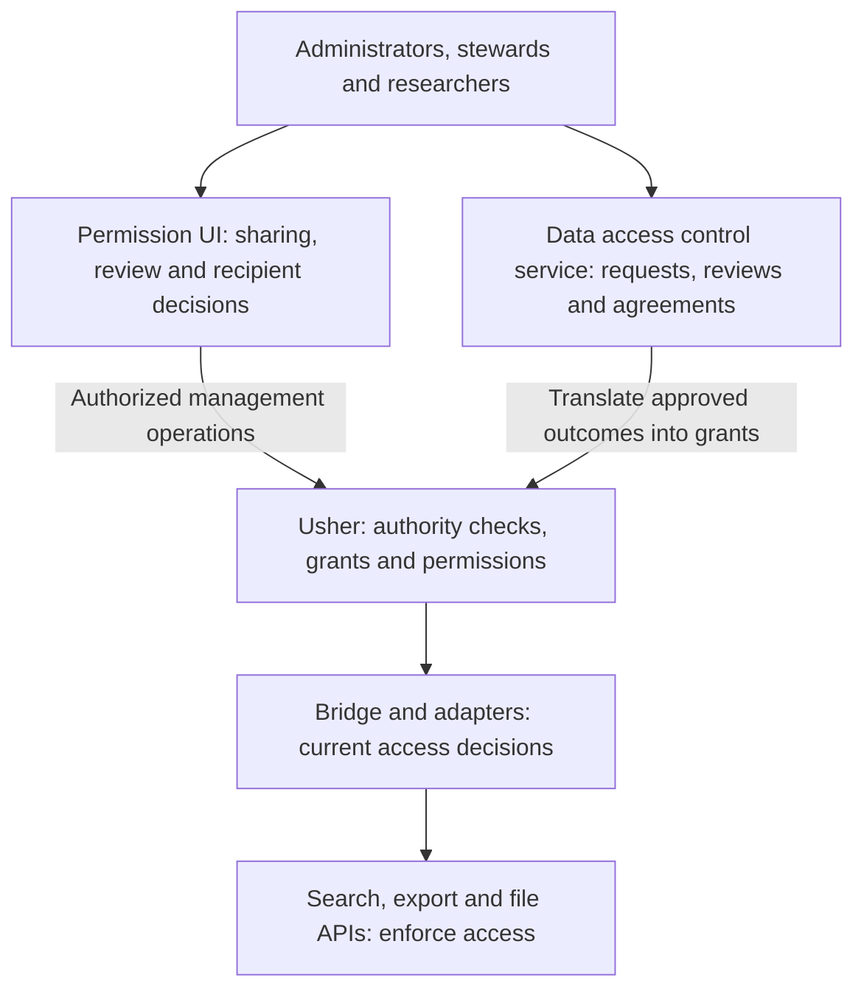

# Building Applications on Usher

:::info Development status and scope
This page describes the planned application architecture. **Permission management UIs and data access control services are developed separately from Usher.** Usher manages policy and grants; applications provide user workflows, and data-service integrations enforce permissions.
:::

Applications can use Usher to manage permissions created through different workflows. A steward sharing a study and a committee approving a request can both create scoped grants. Search and file services then enforce those grants independently of the approval workflow.

## Application Architecture

The permission UI and data access control service can share a portal and backend. The diagram shows their responsibilities; deployment boundaries depend on the application. Authentication is handled by the configured identity provider.

## Permission Management UI

A permission management UI lets administrators, stewards, and recipients manage access using project terminology, such as studies or datasets.

| User task | Usher functionality | Application functionality |
| --- | --- | --- |
| Set up a study and assign submitters | Resources and authorized assignments. | Setup forms, project labels, identity lookup, and validation of the intended scope. |
| Share with a colleague | Scoped grants and checks on the grantor's authority. | Recipient selection, a clear explanation of access, confirmation, and invitation delivery. |
| Accept or decline access | Recipient decisions that affect effective permissions. | An invitation inbox, a description of the offered access, and a response workflow. |
| Review or revoke access | Grant inspection and revocation mechanisms. | A “who can access this?” view, pending/active state, safeguards, and feedback about withdrawal. |
| Delegate stewardship | Resource management authority and its constraints. | Transfer workflows, account-removal handling, and protection against leaving data unmanaged. |

System administrators and data stewards have different permissions. The UI should present the operations available to each user, and Usher must check authority on every management request. Each project also needs policies for exceptional administrative access and account recovery.

The UI should support routine grant changes without requiring users to edit JSON. Changes to data mappings or schemas still require integration review to confirm which records each category selects.

## Data Access Control Service

A data access control service manages access requests and approvals according to project policy. It uses Usher to record and evaluate the resulting permissions.

A typical request workflow includes the following steps:

1. A researcher requests a defined scope of data for a stated purpose.
2. The application collects the information and agreements required by the project.
3. Authorized reviewers assess the request and record an approval or refusal.
4. The service creates grants with the approved recipient, resource, category, role, and any supported expiry. Usher checks that the service is authorized to create those grants.
5. The researcher accepts the offered access where required. The bridge and data services enforce the resulting permissions.
6. The application manages renewals, withdrawal, notifications, and review history, keeping its workflow state aligned with grant state.

The application must implement request forms, review queues, committee membership, agreements, renewal reminders, and any appeals process. These workflows are outside Usher's scope.

Approval and grant creation are separate operations. Handle failures between them so an approved request can be retried without creating duplicate grants.

A study-based approval can map to a grant covering the whole resource. Attribute-based approval requires category definitions and data mappings. Sharing a cohort defined by an arbitrary search query requires further support in the permission model and integration.

## Service Integrations

Each API that serves data must enforce permissions. Arranger filters records and aggregates before returning a response. Export and file services check their own requests, including direct API calls and previously obtained links. The shared bridge keeps permissions current, and adapters apply them within each service.

Test search, exports, saved results, and downloads separately against the same policy. Include direct requests that bypass the portal and failures in the authorization service.

Monitoring and audit tools should connect approval decisions, grant changes, and access events. Usher provides records for these tools; the application must define reporting, retention, and permissions for viewing the history.

## Implementation Stages

| Stage | Validation | Additional work |
| --- | --- | --- |
| **Authorization service and integration** | Verify that grants and recipient decisions produce the expected access. Test denial, revocation, and authorization failures. | User-facing management workflows and any data services not yet integrated. |
| **Permission management UI** | Verify sharing, recipient acceptance, access review, and authorized administrator setup. | Project-specific request, review, agreement, and renewal workflows. |
| **Data access control service** | Test the request and review workflow through grant creation, revocation, and recovery from partial failures. | Validation of each additional project's policy and deployment. |

Use the [user and project requirements](03-user-project-requirements.md) as acceptance criteria for each stage. Project-specific policies and integrations need to be validated before deployment.
