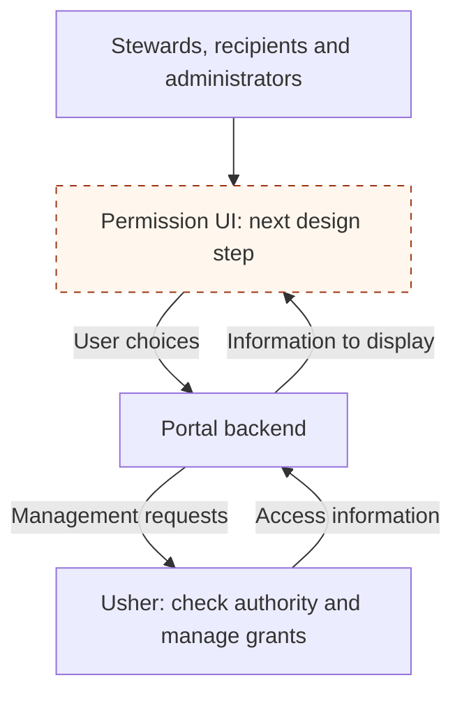

# Permission Management

The [Overview](01-overview.md) and [concrete examples](03-concrete-examples/index.md) describe Usher's backend functionality. The next step is designing how users reach that functionality through a permission interface and maintain their policies over time.

The purpose of this interface is to turn access decisions into understandable tasks: share a study, review who can access it, answer an invitation, or revoke a grant. The workflow and sustainability goals below are a design direction to validate with users.

## Connecting users to the backend

A permission interface would sit within a platform's portal. The portal's backend would send authorized management requests to Usher and return the information needed to display access.

| User                     | Intended task                                               | Backend functionality                                      |
| ------------------------ | ----------------------------------------------------------- | ---------------------------------------------------------- |
| **Data Steward**         | Share a study, review recipients, and revoke access         | Create, inspect, and revoke grants within their authority  |
| **Data Consumer**        | Understand their access and accept or decline an invitation | Inspect their grants and record their acceptance decisions |
| **System Administrator** | Set up studies and assign submitters                        | Manage resources and the relevant assignments              |

In iMS, submission also establishes stewardship. The permission experience would need to connect to that submission workflow.

Usher would check the authority for each management request. Arranger and file services would continue enforcing access on data requests, including requests made outside the portal.

## Following a worked example

For the illustrative `STUDY_A` example, the interface would let a steward choose a recipient and understand the access being offered. The backend would represent that choice as a grant naming the resource, category, and role.

The recipient would see what is being shared and accept or decline. The backend would record that decision and compute the resulting permissions. A later revocation would remove the access conferred by the grant.

The interface design needs to make these effects clear without asking users to read a permissions token or understand the underlying query mapping.

## Making policy maintenance sustainable

The backend separates changes to grants from changes to data mappings. The permission interface should make that separation useful to the people responsible for access.

The next design step should establish:

- **Understandable choices:** use the platform's terms, such as studies, and explain the data and actions covered by a grant.
- **Routine maintenance:** let authorized users review recipients, change grants, and remove access without developer assistance.
- **Clear responsibility:** distinguish steward decisions, administrator setup, and integration work when schemas or applications change.
- **Review and accountability:** show acceptance and access changes clearly, and connect policy reviews to the backend audit record.

Each worked example can supply a small scenario for testing these goals with users. That work should establish the screens, safeguards, guidance, and ownership needed for people to keep policies accurate over time.
